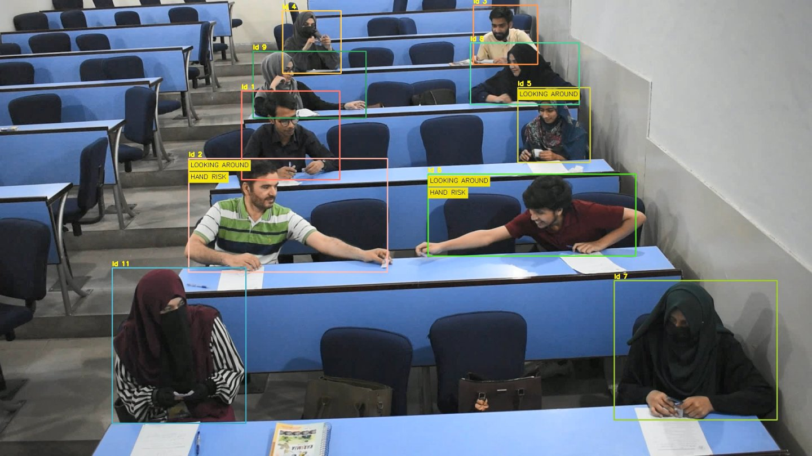
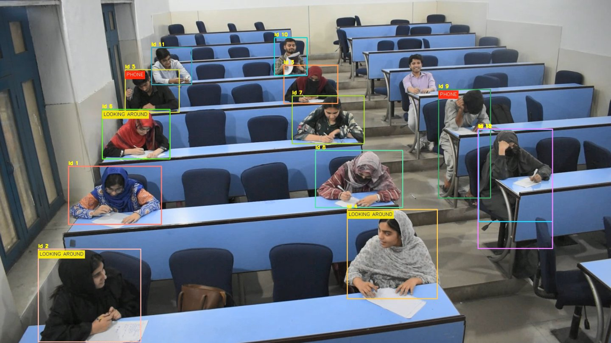
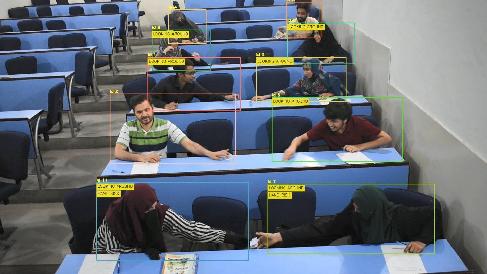
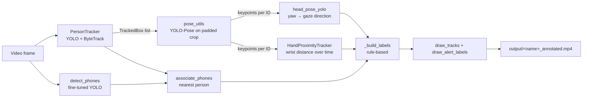

# Proctoring AI: Exam Cheating Detection

A computer vision pipeline that analyses wide-angle classroom exam footage and flags suspicious behaviour per student: **phone use**, **looking around**, and **passing paper/notes between neighbours**.

One corner-mounted camera covers 10+ students at once. Every student gets a persistent track ID, and each frame is annotated with simple rule-based labels. There is no risk score; every label comes straight from a raw signal, so it is always clear why a student was flagged.

<p align="center">
  
  <br><em>Paper passing between ID 2 and ID 6: their wrists stay close for 10+ frames while they look sideways, so both get <code>HAND RISK</code>.</em>
</p>

---

## What it detects

| Label | Colour | Condition |
|---|---|---|
| `PHONE` | red | The phone detector finds a phone and assigns it to this student (nearest box centre, ≤ 300 px). |
| `LOOKING AROUND` | yellow | Head yaw estimated from pose keypoints is `SIDE` (≥ 20°) or `AWAY` (≥ 50°). |
| `HAND RISK` | yellow | Wrists of two students stay closer than **1.5 × their average shoulder width** for **10 consecutive frames**, *and* at least one of them is looking `SIDE`/`AWAY`. |

The gaze cross-check on `HAND RISK` matters. Without it, two neighbours writing side by side with their hands near each other would be flagged all the time. With it, the label only fires when someone is also turning towards the other person.

<table>
  <tr>
    <td width="50%"></td>
    <td width="50%"></td>
  </tr>
  <tr>
    <td><em><code>PHONE</code> on ID 5 and ID 9 (red), and <code>LOOKING AROUND</code> on students turned towards their neighbours.</em></td>
    <td><em>A second pair (ID 11 and ID 7) passing a note in the front row. The earlier pair's counter has reset.</em></td>
  </tr>
</table>

---

## How it works



For each frame:

1. **Track people.** `PersonTracker` runs YOLO (`yolo26m.pt`, person class only, `imgsz=1280`) with ultralytics' built-in ByteTrack and returns `TrackedBox(track_id, x1, y1, x2, y2, conf)`.
2. **Estimate pose once.** `pose_utils` crops each person with 10% padding, runs YOLO-Pose on the crop, and maps the 17 COCO keypoints back to frame coordinates. These keypoints feed both the gaze and the hand modules, so pose inference never runs twice.
3. **Gaze.** `head_pose_yolo` measures the horizontal offset of the nose from the shoulder midpoint (or the eye midpoint if shoulders are not visible), normalised by shoulder/eye width and scaled to degrees. The result is `FORWARD` (< 20°), `SIDE` (< 50°), `AWAY`, or `FACE_NOT_VISIBLE`.
4. **Hands.** `HandProximityTracker` takes every pair of students, finds their closest visible wrists, and divides that distance by the pair's average shoulder width. A per-pair counter counts consecutive "close" frames. The pair becomes `is_sustained` at 10 frames, and the counter resets as soon as the wrists move apart or a keypoint disappears.
5. **Phones.** A separate fine-tuned YOLO (`best11m.pt`, conf ≥ 0.65) runs on the full frame. Each phone is assigned to the nearest tracked student.
6. **Label and draw.** `main._build_labels()` checks the three conditions above independently. Track boxes are drawn with `supervision`'s `BoxAnnotator`, and the labels are stacked inside each box.

---

## Project structure

```
core/                    # detection logic only, no drawing or video I/O
  tracker.py             # PersonTracker, TrackedBox, draw_tracks
  pose_utils.py          # shared YOLO-Pose inference + keypoint indices
  head_pose_yolo.py      # yaw estimation, GazeDirection
  hand_proximity.py      # HandProximityTracker (stateful, per-pair counters)
  detector.py            # detect_phones, associate_phones
reporting/
  visualizer.py          # draw_alert_labels, draw_hand_proximity
tests/                   # per-module demo scripts on real video (cv2.imshow)
  test_tracker.py  test_detector.py  test_head_pose_yolo.py
  test_hand_proximity.py  test_visualizer.py (synthetic, no model needed)
main.py                  # run_pipeline(): wires everything together
run.py                   # quick launcher with a list of test videos
docs/images/             # README screenshots
```

Not in the repo (git-ignored): `models/` (weights), `Data/` (videos), `output/` (annotated results).

---

## Setup

Requirements: Python 3.10+, a CUDA GPU (models are loaded with `.to("cuda")`), and the following packages:

```bash
pip install ultralytics supervision opencv-python numpy
```

The author's environment is the conda env `ai_vision`:

```bash
conda activate ai_vision
```

Put the weights in `models/`:

| File | Purpose |
|---|---|
| `yolo26m.pt` | person detection + tracking |
| `yolov8m-pose.pt` | pose keypoints |
| `best11m.pt` | phone detection (fine-tuned YOLO) |

> **Note:** the default model paths in `main.py` and `tests/*.py` are absolute (`E:\Exam  Cheating detection\models\...`). Pass your own paths, or edit the defaults, if your checkout lives somewhere else.

---

## Usage

```python
import main

out = main.run_pipeline(
    r"Data\Group\v5\DSC_0080.MOV",
    person_model_path=r"models\yolo26m.pt",
    pose_model_path=r"models\yolov8m-pose.pt",
    phone_model_path=r"models\best11m.pt",
    show_live=False,     # True opens a preview window; press q to stop
    max_frames=None,     # e.g. 60 for a quick smoke test
)
print(out)               # output/DSC_0080_annotated.mp4
```

Or edit the video list in `run.py` and run:

```bash
python run.py
```

To check a single module on a video:

```bash
python tests/test_tracker.py
```

```bash
python tests/test_visualizer.py
```

`test_visualizer.py` uses synthetic boxes and needs no model.

### Tuning knobs

| Where | Constant | Default |
|---|---|---|
| `main.py` | `HAND_DISTANCE_RATIO` | `1.5` |
| `main.py` | `HAND_CONSECUTIVE_FRAMES` | `10` (frames, so it depends on the video's FPS) |
| `core/head_pose_yolo.py` | `GazeConfig.side_threshold` / `away_threshold` | `20°` / `50°` |
| `core/detector.py` | `detect_phones(conf=…)` / `associate_phones(max_distance=…)` | `0.65` / `300 px` |
| `core/pose_utils.py` | `PoseConfig` keypoint conf / crop padding | `0.3` / `0.1` |

---

## Validation

Labelled clips for each behaviour (phone use, looking around, paper passing, copying) are used **only as ground truth for checking results, never for training**. Evaluation is qualitative: known videos are run through the pipeline, and the annotated output is reviewed by hand for false positives and misses. There are no precision/recall numbers yet.

## Known limitations

- **Small phones.** At this camera distance a phone is about 15–25 px, so phones are easy to miss. A crop-based second pass or SAHI slicing is the planned fix.
- **`LOOKING AROUND` is noisy.** Yaw comes from a 2D nose offset, so a student leaning over the paper or talking to the side also triggers it (see the screenshots above).
- **ID switches.** ByteTrack can reassign an ID after occlusion (for example, a student reappearing with a new ID), which resets the hand-proximity counter for that pair.
- **Frame-based timing.** The 10-frame window is not converted to seconds, so the effective duration depends on FPS.
- **`copying` is not detected** as its own label yet.

## Future work

Seat mapping, an instructor dashboard, audio-based talking detection, face blurring for privacy, and edge-device optimisation.
