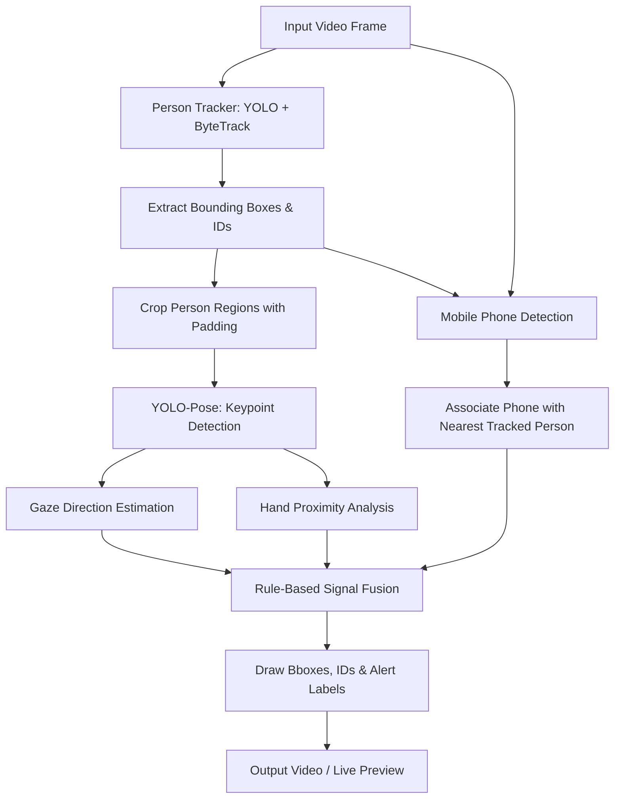

# 🚀 Proctoring AI: Exam Cheating Detection

An automated, real-time computer vision proctoring system designed to analyze classroom exam video feeds. The system tracks multiple students simultaneously, detects mobile phone usage, estimates gaze directions (looking around), and flags suspicious physical interactions (e.g., passing papers or notes via hand-proximity tracking).

Developed with a modular design, the pipeline runs high-precision object detection, pose estimation, and geometric heuristics to provide clear visual cues of student behavior without complex risk-scoring overhead.

---

## ✨ Key Features

- **Multi-Student Tracking:** Uses YOLO combined with the **ByteTrack** algorithm to detect students and assign persistent tracking IDs, allowing individual tracking of 10+ students.
- **Head Pose & Gaze Estimation:** Computes yaw angles using relative nose-to-shoulder or nose-to-eye offsets. Categorizes gaze into `FORWARD`, `SIDE`, `AWAY`, or `FACE_NOT_VISIBLE`.
- **Hand Proximity Tracking:** Detects physical material sharing by measuring the physical distance between students' wrists relative to their average shoulder width.
- **Mobile Phone Detection:** Utilizes a custom-trained YOLO model to detect mobile phones and associates them with the nearest tracked student's bounding box.
- **Multi-Signal Alert Tagging:** Combines raw behavioral signals through strict, rule-based heuristics to display warning flags on the video output:
  - `PHONE`: Mobile phone detected and associated with the student.
  - `LOOKING AROUND`: Student gaze directed to the `SIDE` or `AWAY`.
  - `HAND RISK`: Sustained wrist-proximity between two students cross-checked with their gaze direction (only triggered if at least one student is looking away from their desk to filter out normal synchronized writing).

---

## 🛠️ Tech Stack & Dependencies

The system runs on the **`ai_vision`** Conda environment. Key libraries and frameworks include:
- **Ultralytics YOLO:** Used for person detection (`yolo26m.pt`), pose estimation (`yolov8m-pose.pt` / `yolo11m-pose.pt`), and custom mobile phone detection (`best11m.pt`).
- **Supervision (Roboflow):** Handles high-performance video streaming reading/writing (`VideoInfo`, `VideoSink`, `get_video_frames_generator`) and object annotation (`BoxAnnotator`).
- **OpenCV:** Manages image rendering, text overlays, frame resizing, and GUI displays.
- **NumPy:** Used for fast spatial calculations and vector operations (e.g., Euclidean distance computation for wrists and head yaw estimation).

---

## 🏗️ Pipeline & Architecture

Below is the sequence of operations for processing each video frame:



1. **Detection & Tracking:** Frame is fed into `PersonTracker` where YOLO locates students and ByteTrack registers their IDs.
2. **Region Cropping:** To optimize pose estimation, each tracked person's bounding box is cropped with a safety padding.
3. **Keypoint Extraction:** YOLO-Pose computes 17 COCO keypoints only within the cropped region. The coordinates are then translated back to the full frame space.
4. **Behavior Analysis:**
   - **Gaze:** Yaw calculation uses the ratio of nose offset relative to eyes/shoulders.
   - **Hands:** Wrists are identified; pairwise wrist-to-wrist distances are normalized against average shoulder widths.
   - **Phones:** Mobile phones are detected on the full frame and mapped to the closest person within a distance threshold.
5. **Heuristic Alerting:** Warnings are triggered when threshold constraints are violated consecutively (e.g., 10 consecutive frames for hand risk).

---

## 📁 Project Structure

```
├── core/
│   ├── tracker.py          # Person tracking using YOLO & ByteTrack (supervision integrated)
│   ├── detector.py         # Phone detection and owner assignment logic
│   ├── pose_utils.py       # Padded person crops & shared YOLO-Pose keypoints extraction
│   ├── head_pose_yolo.py   # Yaw angle calculation & gaze direction classification
│   └── hand_proximity.py   # Wrist proximity tracking and temporal thresholding
├── reporting/
│   └── visualizer.py       # Rendering of bounding boxes, connecting lines, and alert labels
├── models/
│   ├── yolo26m.pt          # Core person detection model weights
│   ├── yolov8m-pose.pt     # Pose estimation model weights
│   └── best11m.pt          # Fine-tuned phone detection model weights
├── tests/
│   ├── test_tracker.py     # Independent test script for student tracking
│   ├── test_detector.py    # Independent test script for phone detection
│   ├── test_head_pose_yolo.py # Independent test script for gaze analysis
│   ├── test_hand_proximity.py # Independent test script for wrist proximity
│   └── test_visualizer.py  # Unit/visual test with synthetic bounding boxes
├── Data/                   # Test videos (Group and Solo folders)
├── output/                 # Destination folder for annotated output videos
├── main.py                 # Main orchestration pipeline script
└── run.py                  # Entry helper script to run the pipeline on test videos
```

---

## ⚙️ Installation & Usage

### 1. Environment Setup
The system requires a conda environment containing the correct versions of OpenCV, PyTorch, and Ultralytics.

```bash
# Activate the dedicated conda environment
conda activate ai_vision
```

### 2. Running the Pipeline
You can run the end-to-end proctoring system using the entry script:

```bash
# Run the pipeline on default test footage with a live preview
python run.py
```

Or run the pipeline programmatically in Python:

```python
import main

# Run the proctoring pipeline on a specific video
annotated_video_path = main.run_pipeline(
    video_path=r"Data\Group\v5\DSC_0080.MOV",
    person_model_path=r"models\yolo26m.pt",
    pose_model_path=r"models\yolov8m-pose.pt",
    phone_model_path=r"models\best11m.pt",
    show_live=True
)
print(f"Processed video saved at: {annotated_video_path}")
```

### 3. Running Modules Separately
To test individual modules, execute the scripts in the `tests/` directory:

```bash
# Test person tracking
python tests/test_tracker.py

# Test head pose/gaze direction detection
python tests/test_head_pose_yolo.py
```

---

## ⚡ Performance & Hardware Notes

This application has been optimized to maintain high frame rates (FPS) and low memory usage under hardware constraints (such as mid-range or entry-level CUDA-enabled GPUs):

1. **Cropped Region Inference (Pose Optimization):** Rather than passing high-resolution full video frames to the YOLO-Pose model, `pose_utils.py` crops a tight window around each tracked student (with safety padding) and passes only the cropped sub-image. This results in significantly faster inference times and a lower memory footprint.
2. **Inference Sharing:** Keypoints are computed once per person per frame and shared between both the head pose classifier and the hand-proximity tracker, preventing redundant model execution.
3. **Frame-Skipping Option:** Visual test scripts (such as `tests/test_tracker.py`) support a `frame_skip` parameter (e.g., updating tracking every 2nd or 3rd frame). This reduces processing overhead for testing and ensures smooth display feedback on slower machines.
4. **CUDA Offloading:** Main scripts explicitly load the PyTorch weights on CUDA (GPU) devices via `.to("cuda")` to prevent CPU bottlenecks.
